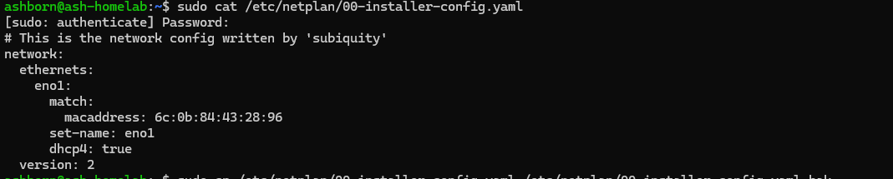
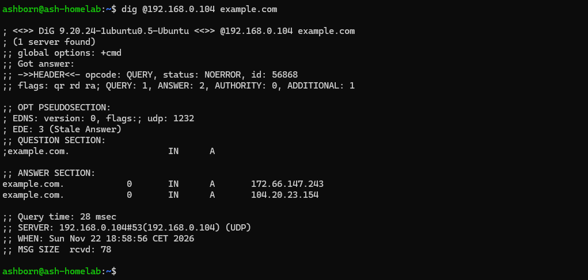
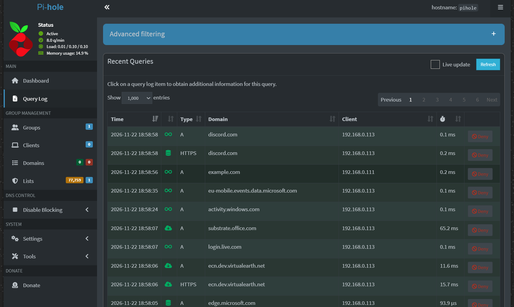

# Pi-hole DNS Integration

Configured my Ubuntu HomeLab to use an existing Raspberry Pi running Pi-hole as its preferred DNS server, with the home router configured as an alternative.

This allows the HomeLab to use Pi-hole's DNS filtering while keeping its existing DHCP network configuration.

## Network Configuration

| Device | IP Address | Purpose |
|---|---|---|
| Ubuntu HomeLab | `192.168.0.111` | Server |
| Raspberry Pi (Pi-hole) | `192.168.0.104` | Preferred DNS |
| Home Router | `192.168.0.1` | Alternative DNS |
| Network Interface | `eno1` | Ethernet |

## Configuration

Ubuntu uses Netplan with `systemd-networkd` to manage its network settings.

The configuration was updated in `/etc/netplan/00-installer-config.yaml`.

```yaml
network:
  ethernets:
    eno1:
      match:
        macaddress: 6c:0b:84:43:28:96
      set-name: eno1
      dhcp4: true
      dhcp4-overrides:
        use-dns: false
      nameservers:
        addresses:
          - 192.168.0.104
          - 192.168.0.1
  version: 2
```



The configuration was validated and applied using:

```bash
sudo netplan generate
sudo netplan try
```

## Verification

### 1. DNS Configuration

```bash
resolvectl status
```

Confirmed that Ubuntu selected Pi-hole as its current DNS server.

```text
Current DNS Server: 192.168.0.104
DNS Servers: 192.168.0.104 192.168.0.1
```

### 2. Network Connectivity

```bash
ping -c 4 192.168.0.104
```

All four packets were received successfully, confirming connectivity between the HomeLab and Raspberry Pi.

### 3. DNS Resolution

```bash
dig @192.168.0.104 example.com
```

The DNS query completed successfully.

```text
status: NOERROR
SERVER: 192.168.0.104#53
```



### 4. Pi-hole Query Log

The DNS request was verified through Pi-hole's web dashboard.

| Field | Result |
|---|---|
| Client | `192.168.0.111` |
| Domain | `example.com` |
| Query Type | `A` |
| Status | Successfully resolved |



## Result

The Ubuntu HomeLab is now integrated with Pi-hole for DNS resolution. The configuration is persistent, DHCP remains enabled, and the connection has been verified through terminal commands and Pi-hole's Query Log.

The router remains configured as an alternative DNS server, so Pi-hole filtering is not guaranteed for every DNS request.
