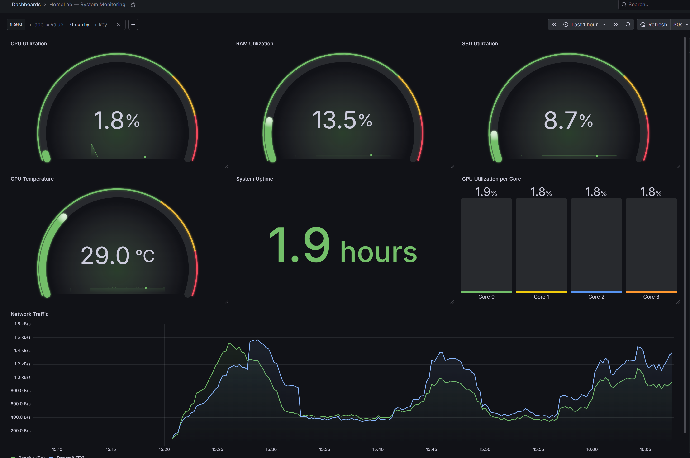

# HomeLab Services

A collection of self-hosted services deployed on my Ubuntu server for system administration, container management, network storage and performance monitoring.

Each service is documented individually, covering its implementation, configuration and integration within the HomeLab.

## Service Overview

| Service | Purpose | Deployment |
|---|---|---|
| [Cockpit](./cockpit/) | Server administration | Native |
| [Samba](./samba/) | Network file sharing | Native |
| [Portainer](./portainer/) | Container management | Docker |
| [Node Exporter](./node-exporter/) | Hardware and system metrics | Docker |
| [Prometheus](./prometheus/) | Metric collection and storage | Docker |
| [Grafana](./grafana/) | Performance visualization | Docker |

## Monitoring

Node Exporter, Prometheus and Grafana form an integrated monitoring stack, providing live system measurements and historical performance data.

### Configuration Files

- [Docker Compose](./monitoring/compose.yaml)
- [Prometheus Configuration](./monitoring/prometheus.yml)

## Implementation

The infrastructure was developed through hands-on configuration, testing and troubleshooting, with a focus on containerization, persistent storage, network security and system administration.

All six services are operational. Automatic recovery after reboot and backup restoration remain to be verified.
