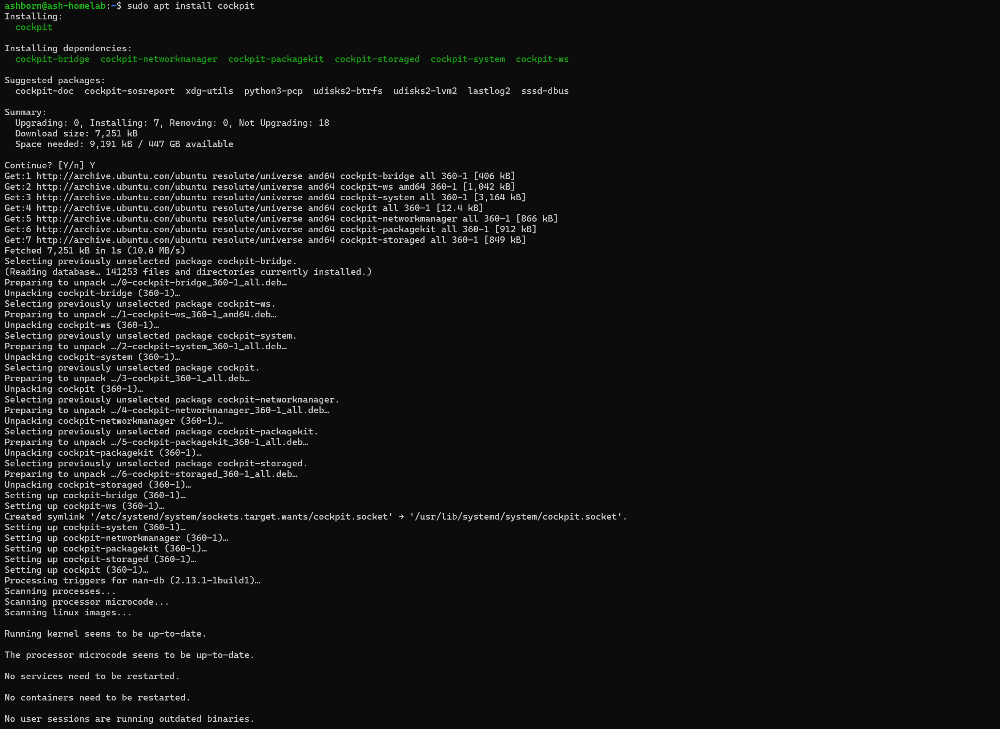
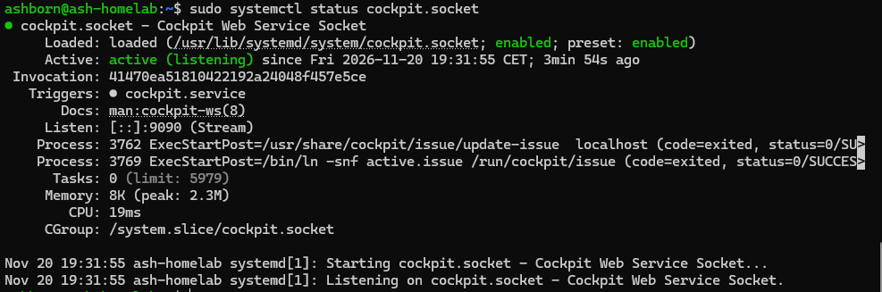
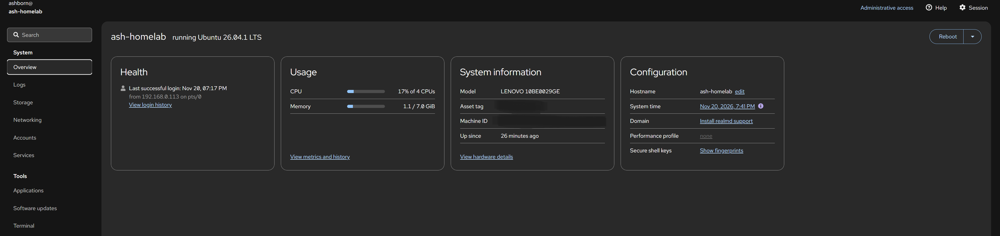

# Cockpit — Server Management

## Overview

Cockpit is a web-based administration tool that I installed on my Ubuntu HomeLab to make managing the server more convenient.

While I use SSH for most command-line tasks, Cockpit provides a graphical interface for monitoring system performance, managing services, checking logs, and handling software updates.

It has been particularly useful for getting familiar with Linux system administration and understanding what's happening on the server.

## Installation

Cockpit was installed using Ubuntu's APT package manager.

```bash
sudo apt update
sudo apt install cockpit
```

After installation, I checked whether the Cockpit socket was running:

```bash
sudo systemctl status cockpit.socket
```

The web interface is accessible over HTTPS on port `9090`, using the existing Ubuntu account credentials.

## Configuration & Security

The server uses UFW to manage incoming connections. I configured the firewall to allow access to Cockpit only from my Windows administration PC on the local network.

Cockpit runs alongside SSH, allowing me to switch between graphical and command-line administration depending on the task.

## Troubleshooting

### Software Updates Reporting Offline

During the initial configuration, Cockpit's Software Updates page reported that the server was offline, even though Ubuntu had a working internet connection.

After investigating, I found that NetworkManager was running alongside `systemd-networkd`, which was actually managing the Ethernet connection.

This affected how PackageKit detected network connectivity.

I resolved the issue by disabling the unused NetworkManager service while keeping `systemd-networkd` active.

Afterward, Cockpit was able to check for and install software updates normally.

## Verification

I verified that Cockpit was enabled and running after a server reboot.

```bash
systemctl is-enabled cockpit.socket
systemctl is-active cockpit.socket
```

Output:

```text
enabled
active
```

This confirms that Cockpit starts automatically and remains available after restarting the server.

## Screenshots

### Installation



### Service Status



### Dashboard



## Result

Cockpit is now part of my HomeLab's administration environment, providing a convenient way to monitor system resources, manage services, and perform software updates without relying entirely on the terminal.
