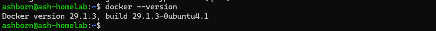
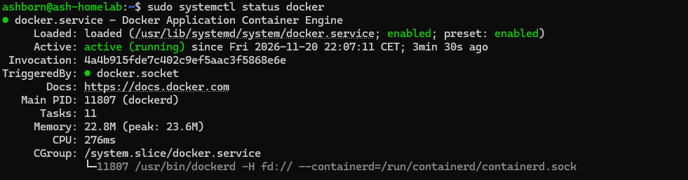
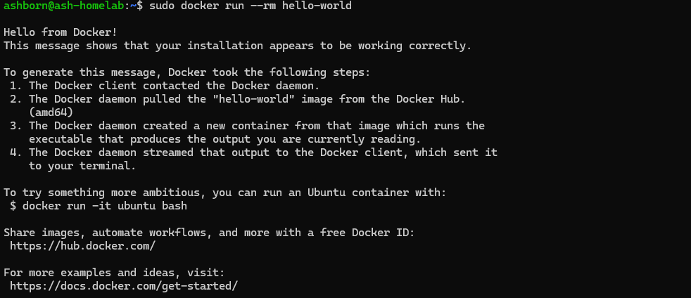

# Docker Engine & Docker Compose

Docker provides the container platform for running and managing applications on my Ubuntu HomeLab. I installed Docker Engine and Docker Compose to prepare the server for hosting containerized services such as Portainer, Jellyfin, and Grafana.

## Installation

Docker Engine and Docker Compose were installed using Ubuntu's package manager.

```bash
sudo apt update
sudo apt install docker.io docker-compose-v2
```

## Installation Verification

| Component | Version / Result |
|---|---|
| Docker Engine | 29.1.3 |
| Docker Compose | 2.40.3 |
| Operating System | Ubuntu |
| Docker Service | Active (running) |
| Hello World Test | Successful |

### Docker Engine

Verified the installed Docker version.

```bash
docker --version
```



### Docker Service

Checked that the Docker daemon was running and enabled.

```bash
sudo systemctl status docker
```



### Docker Compose

Verified that Docker Compose was available.

```bash
docker compose version
```


### Container Test

Ran the official Hello World container to confirm that Docker could download an image, create a container, and execute it successfully.

```bash
sudo docker run --rm hello-world
```



### Running Containers

Checked the currently running containers.

```bash
sudo docker ps
```


The output showed no running containers at the time of verification.

## Summary

Docker Engine and Docker Compose are installed and working on the HomeLab. The Docker service is enabled, and the Hello World test completed successfully.

This establishes the foundation for deploying and managing containerized applications in the next stages of the HomeLab project.
