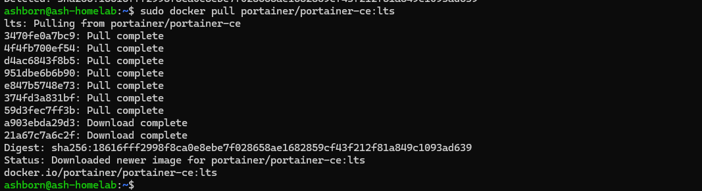
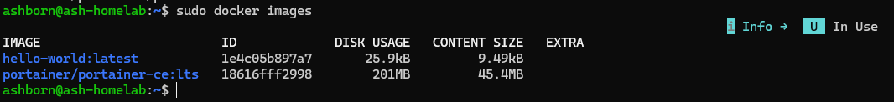
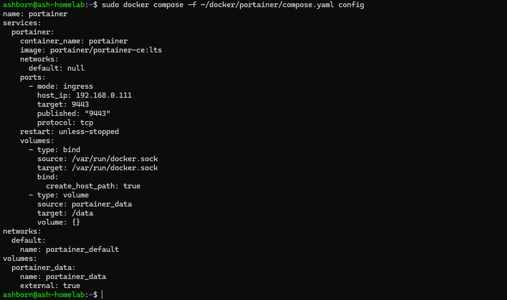
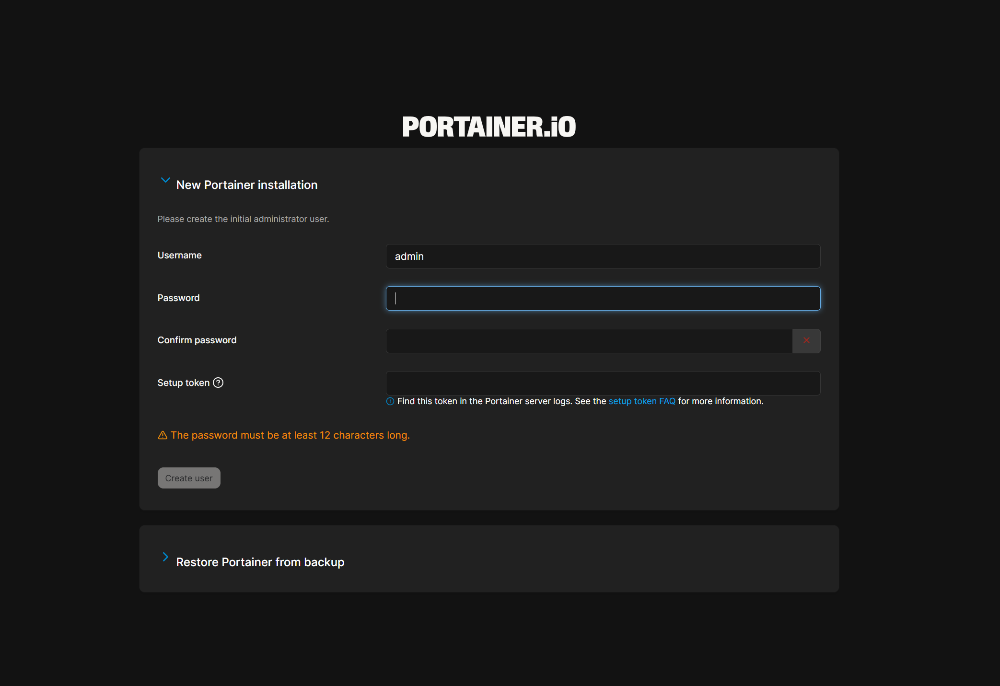
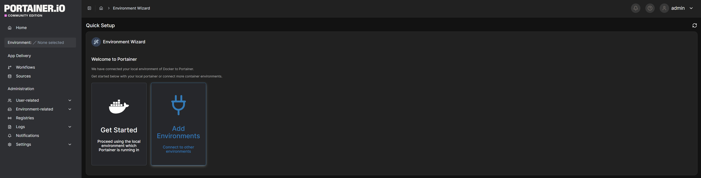
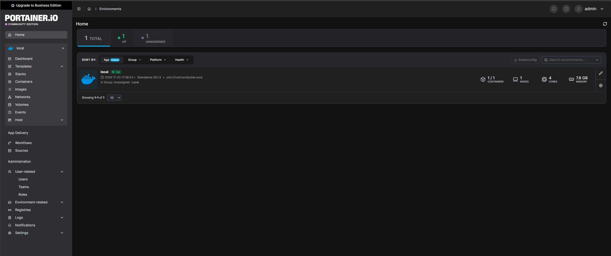

# Portainer — Docker Management

Portainer is a web-based interface for managing Docker containers, images, networks, and volumes. I installed Portainer Community Edition on my Ubuntu HomeLab to make container management easier while learning Docker and Linux administration.

## HomeLab Configuration

| Component | Configuration |
|---|---|
| Host | Lenovo ThinkCentre M83 |
| Operating System | Ubuntu 26.04 LTS |
| Container Platform | Docker Engine |
| Application | Portainer Community Edition (LTS) |
| HomeLab IP | `192.168.0.111` |
| Port | `9443` (HTTPS) |
| Persistent Storage | `portainer_data` |

## Installation

### 1. Download the Portainer Image

First, I downloaded the Portainer Community Edition image from Docker Hub.

```bash
sudo docker pull portainer/portainer-ce:lts
```


  

I verified that the image was available locally using:

```bash
sudo docker images
```



### 2. Configure Docker Compose

I created a dedicated directory for the Portainer configuration.

```bash
mkdir -p ~/docker/portainer
nano ~/docker/portainer/compose.yaml
```

The Compose file defines the Portainer container, its HTTPS port, and persistent storage.

```yaml
services:
  portainer:
    image: portainer/portainer-ce:lts
    container_name: portainer
    restart: unless-stopped

    ports:
      - "192.168.0.111:9443:9443"

    volumes:
      - /var/run/docker.sock:/var/run/docker.sock
      - portainer_data:/data

volumes:
  portainer_data:
    external: true
```

The existing `portainer_data` volume was reused to provide persistent storage.

I validated the configuration before starting the container:

```bash
sudo docker compose -f ~/docker/portainer/compose.yaml config
```



### 3. Configure Network Access

Portainer uses HTTPS on TCP port `9443`. I added a UFW rule to allow access from my Windows PC.

```bash
sudo ufw allow from 192.168.0.113 to 192.168.0.111 port 9443 proto tcp
```

Since Docker manages its own networking rules, I also configured an additional restriction in the `DOCKER-USER` iptables chain.

A custom firewall script and systemd service were created to reapply the rule when Docker starts.

| Configuration | Purpose |
|---|---|
| `portainer-firewall.sh` | Applies the Docker firewall restriction |
| `portainer-firewall.service` | Runs the firewall script during Docker startup |

The firewall rule and systemd service were verified successfully. Testing from another device and reboot persistence verification remain to be completed.

### 4. Start the Portainer Container

I started Portainer using Docker Compose.

```bash
sudo docker compose -f ~/docker/portainer/compose.yaml up -d
```

Docker created the `portainer_default` network and started the Portainer container.

I can verify running containers using:

```bash
sudo docker ps
```

### 5. Configure the Web Interface

I opened the Portainer dashboard from my Windows PC:

`https://192.168.0.111:9443`



After creating the administrator account, I skipped the optional Edge Compute configuration and selected the local Docker environment.



### 6. Portainer Dashboard

The dashboard successfully detected my local Docker environment.



| Resource | Detected |
|---|---|
| Environment | `local` |
| Status | Up |
| Containers | 1 running |
| Nodes | 1 |
| CPU cores | 4 |
| Host memory | 7.6 GB |

## What I Learned

- How Docker images, containers, and volumes work together.
- How Docker Compose simplifies container deployment.
- How IP addresses and TCP ports identify network services.
- How Portainer communicates with Docker through the Docker socket.
- How UFW, iptables, and systemd are used in Linux service administration.

Portainer now provides a central dashboard for managing future Docker-based services on my HomeLab.
