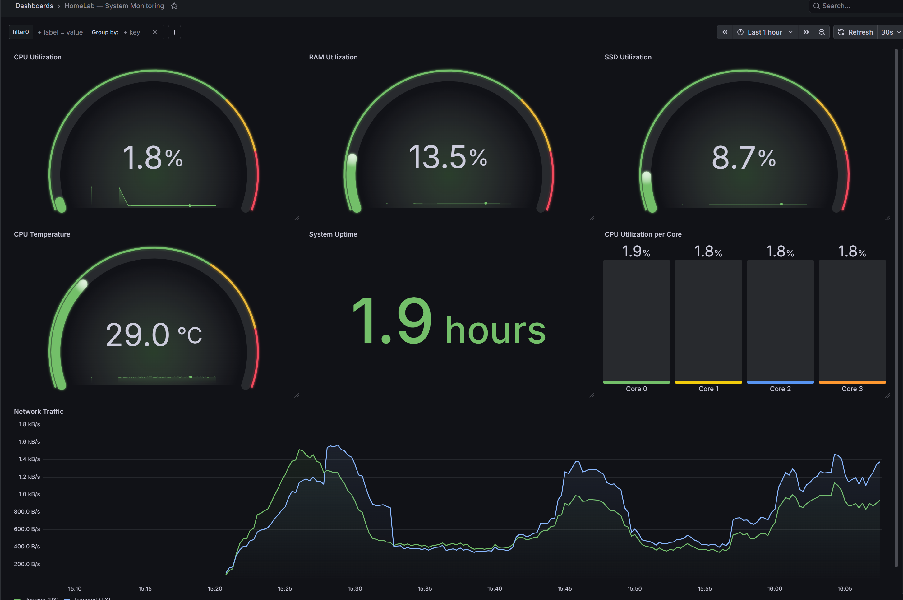
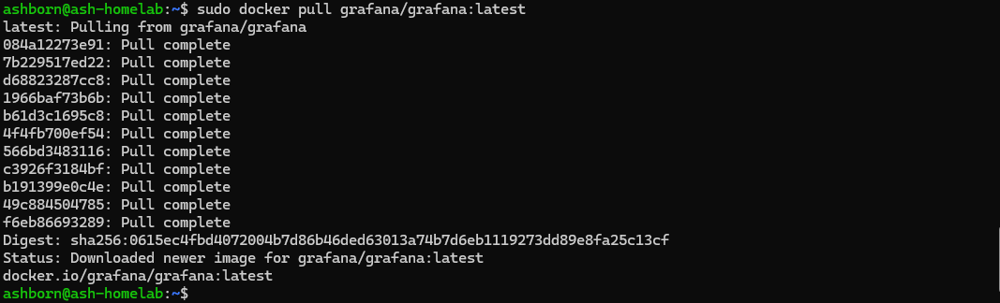
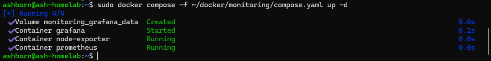
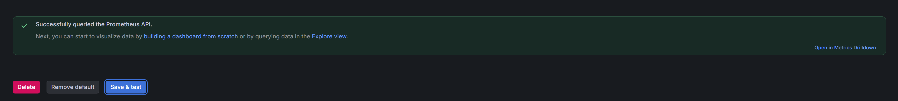
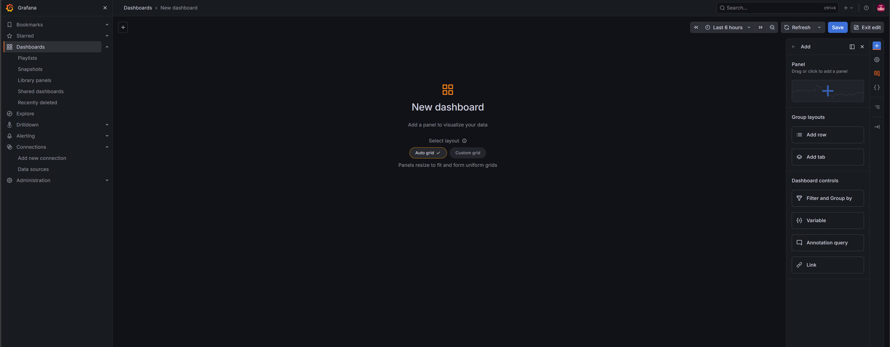

# Grafana

A custom system monitoring dashboard developed to provide a centralized view of my HomeLab's performance, hardware utilization and network activity.

## Deployment

Grafana was deployed using Docker Compose with persistent storage for dashboard configurations and settings.

## Data Source Integration

Grafana communicates with Prometheus through the internal Docker network, using the following data source:

`http://prometheus:9090`

## Dashboard Development

Rather than importing a prebuilt dashboard, I developed individual monitoring panels using PromQL and customized visualizations.

| Monitoring parameter | Visualization |
|---|---|
| CPU utilization | Gauge |
| RAM utilization | Gauge |
| SSD filesystem utilization | Gauge |
| CPU temperature | Gauge |
| System uptime | Stat |
| Individual CPU cores | Vertical bar gauge |
| Network traffic | Time series |

## Configuration

| Parameter | Configuration |
|---|---|
| Docker image | `grafana/grafana:latest` |
| Port | 3000 |
| Data source | Prometheus |
| Refresh interval | 30 seconds |
| Storage | Persistent Docker volume |
| Remote access | SSH port forwarding |

Grafana is bound to localhost and accessed through an SSH tunnel rather than being directly exposed to the local network.

## Future Improvements

- Custom dashboard theme
- SSD health monitoring
- Automated system alerts
- Additional hardware metrics
