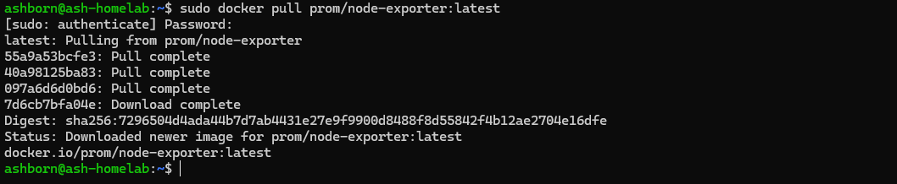

# Node Exporter

Node Exporter is the foundation of my HomeLab monitoring infrastructure, providing hardware and operating system metrics for continuous performance monitoring.

## Installation & Deployment

Node Exporter was deployed using Docker Compose on an Ubuntu server.

The initial deployment used Docker's bridge networking and read-only access to the host filesystem.

## Configuration

| Parameter | Final configuration |
|---|---|
| Docker image | `prom/node-exporter:latest` |
| Port | 9100 |
| Network mode | Host |
| PID namespace | Host |
| Filesystem access | Read-only |
| Restart policy | Unless stopped |

## Collected Metrics

| Category | Measurements |
|---|---|
| CPU | Overall and individual core utilization |
| Memory | RAM utilization |
| Storage | Filesystem utilization |
| Temperature | CPU package temperature |
| System | Uptime |
| Network | Incoming and outgoing Ethernet traffic |

## Network Configuration

During testing, I discovered that Docker's bridge networking limited visibility to container-level network interfaces.

To resolve this, I switched Node Exporter to host networking, enabling access to the physical Ethernet interface (`eno1`). A restricted UFW rule was configured to allow Prometheus to collect metrics through the monitoring network.

## Verification

Node Exporter is operational and successfully provides system metrics to [Prometheus](../prometheus/).

Network configuration persistence after a server reboot remains to be verified.
