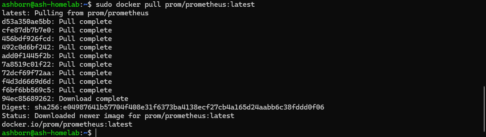
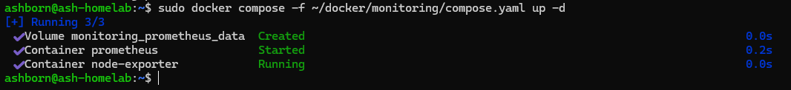
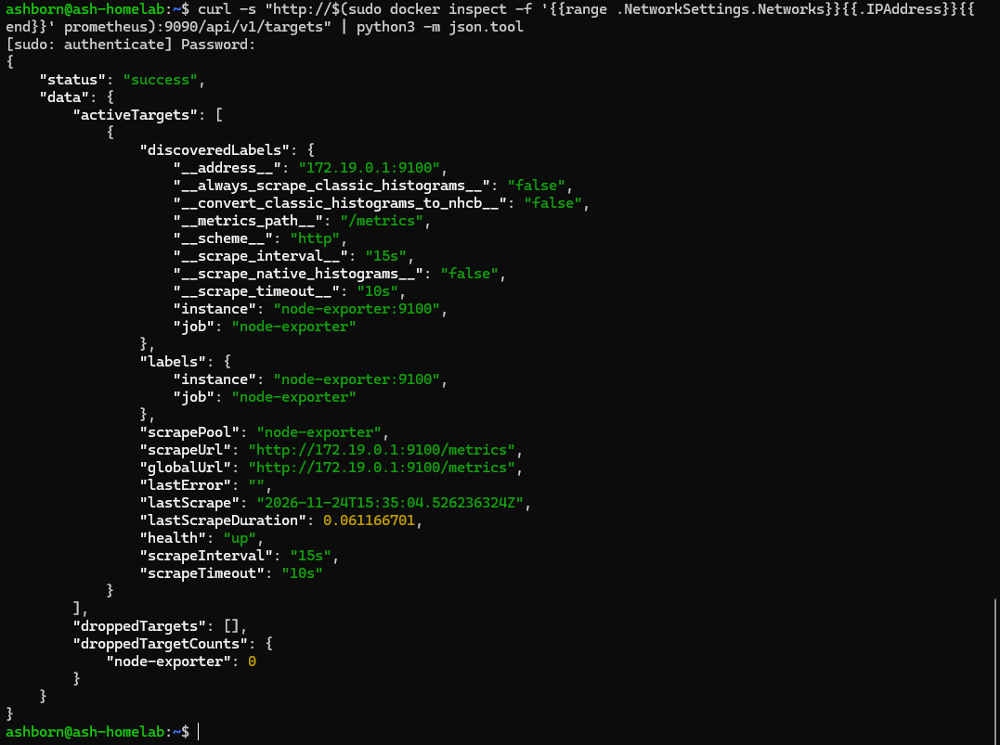

# Prometheus

Prometheus is the central metric collection and storage service of my HomeLab, providing historical system data for performance analysis and monitoring.

## Deployment

The Prometheus Docker image was downloaded and deployed using the existing monitoring stack.

A persistent Docker volume was created to retain collected metrics across container restarts.

## Configuration

| Parameter | Configuration |
|---|---|
| Docker image | `prom/prometheus:latest` |
| Internal port | 9090 |
| Scrape interval | 15 seconds |
| Scrape timeout | 10 seconds |
| Storage volume | `monitoring_prometheus_data` |
| Metric source | Node Exporter |
| Query language | PromQL |

## Metric Collection & Verification

Following the migration of Node Exporter to host networking, I updated the scrape target while retaining the original instance label for consistent dashboard queries.

The Prometheus API was used to verify the connection and successful metric collection.

| Verification | Result |
|---|---|
| API status | Success |
| Target health | Up |
| Scrape errors | None |
| Scrape duration | 61.17 ms |
| Dropped targets | 0 |

The collected metrics are now available for querying and visualization through [Grafana](../grafana/).

Reboot persistence remains to be verified.
